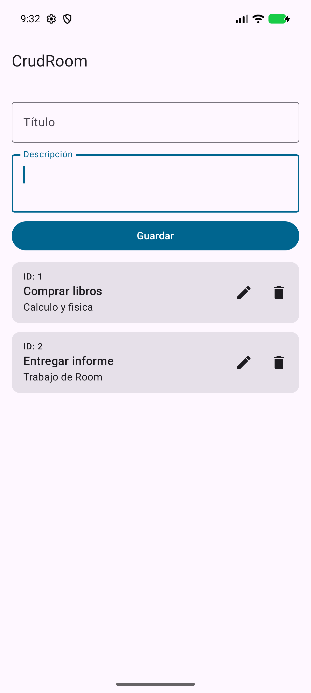
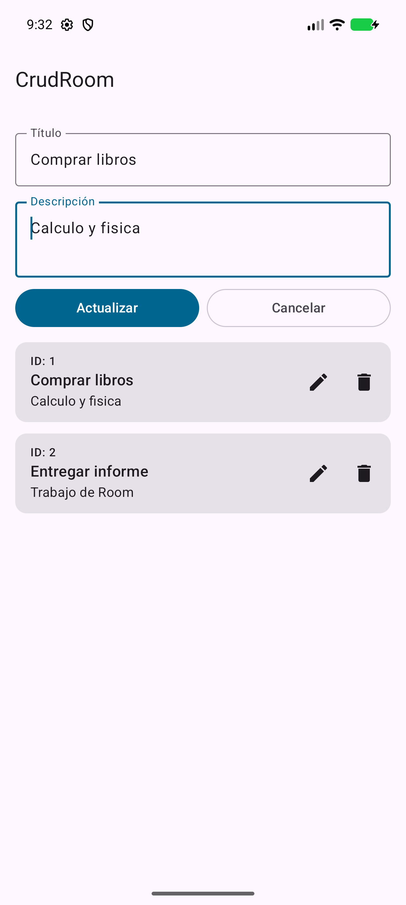
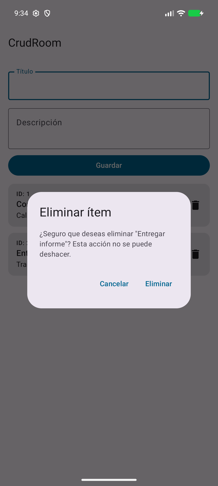
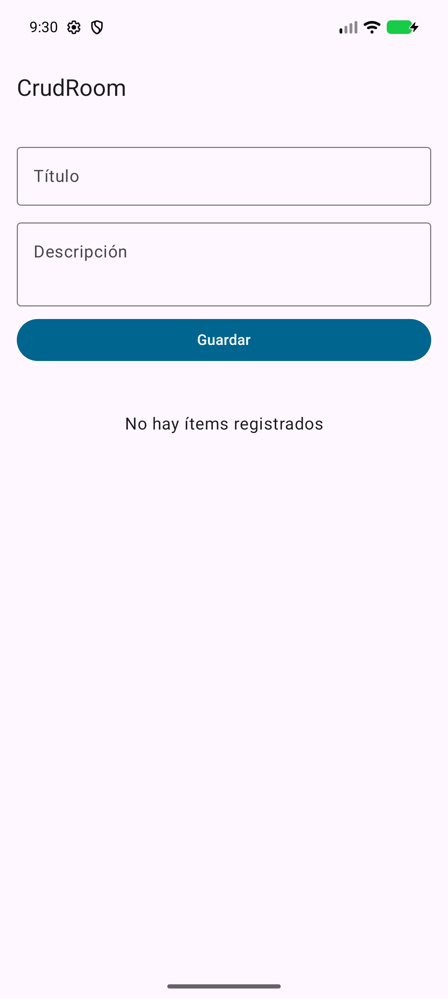
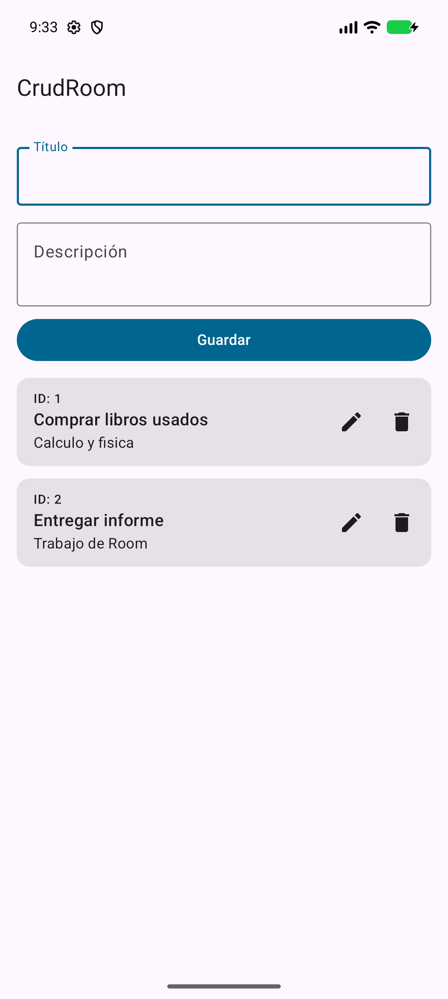
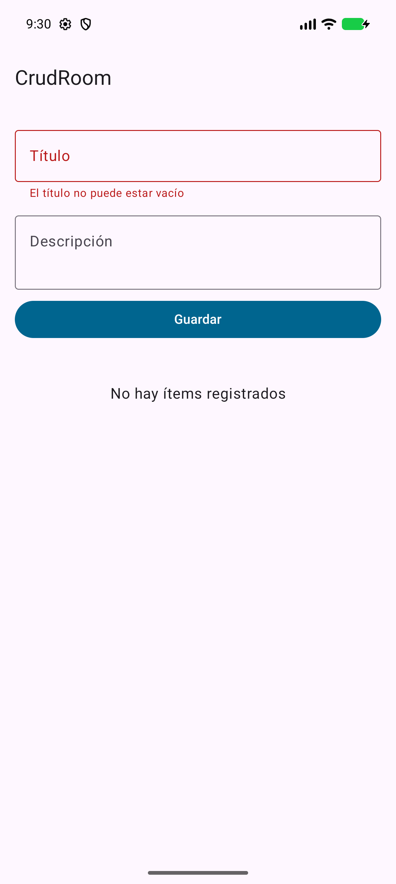

# CrudRoom

Aplicación Android que implementa un CRUD (crear, leer, actualizar y eliminar) sobre una base de datos local SQLite, usando Room y una interfaz hecha por completo con Jetpack Compose.

Cada ítem tiene un id, un título y una descripción. Los datos se conservan aunque se cierre la app.

<p>
  
  
  
</p>

## Tecnologías

| Tecnología | Versión | Para qué se usa |
|---|---|---|
| Kotlin | 2.3.21 | Lenguaje de programación |
| Jetpack Compose (BOM) | 2026.09.00 | Interfaz declarativa con Material 3 |
| Room | 2.8.5 | Capa de acceso a SQLite |
| KSP | 2.3.13 | Genera el código de Room al compilar (en lugar de kapt) |
| Android Gradle Plugin | 9.4.1 | Compilación de la app |
| Gradle | 9.6.0 | Sistema de compilación, con Kotlin DSL y version catalog |
| Coroutines y Flow | (incluidas con Room) | Operaciones asíncronas y datos reactivos |

- SDK mínimo: 24 (Android 7.0). SDK de compilación y objetivo: 37.
- `room-ktx` no se declara como dependencia porque, desde Room 2.7, está fusionado con `room-runtime`.
- AGP 9 trae Kotlin integrado, por eso no se aplica el plugin `org.jetbrains.kotlin.android`.

## Arquitectura

```text
Entity -> DAO -> Database (singleton) -> Repository -> ViewModel -> UI (Compose)
```

Cada capa solo conoce a la siguiente hacia los datos. Cuando la interfaz pide un cambio, este baja hasta SQLite. Room detecta el cambio y el `Flow` de lectura emite la lista nueva, que vuelve a subir hasta la pantalla. Por eso la lista se actualiza sola, sin recargarla a mano.

## Estructura de carpetas

```text
.
├── build.gradle.kts              Plugins del proyecto (sin aplicar)
├── settings.gradle.kts           Repositorios y módulos
├── gradle/
│   ├── libs.versions.toml        Version catalog: todas las versiones
│   └── wrapper/                  Gradle Wrapper
├── docs/capturas/                Capturas de pantalla de este README
└── app/
    ├── build.gradle.kts          Configuración y dependencias de la app
    └── src/main/
        ├── AndroidManifest.xml
        ├── res/                  Textos, tema e ícono
        └── java/com/samuel/crudroom/
            ├── MainActivity.kt   Conecta las capas y muestra la interfaz
            ├── data/
            │   ├── local/
            │   │   ├── ItemEntity.kt     Tabla "items_trabajo"
            │   │   ├── ItemDao.kt        Operaciones CRUD
            │   │   └── AppDatabase.kt    Base de datos singleton "db_trabajo_room"
            │   └── repository/
            │       └── ItemRepository.kt Intermediario entre ViewModel y DAO
            └── ui/
                ├── screens/
                │   └── PantallaItems.kt  Formulario, lista, tarjetas y diálogo
                ├── theme/
                │   └── Theme.kt          Colores de Material 3
                └── viewmodel/
                    ├── ItemViewModel.kt         Estado y lógica del CRUD
                    └── ItemViewModelFactory.kt  Crea el ViewModel con su repositorio
```

## Cómo abrirlo y ejecutarlo en Android Studio

1. Clona o descarga este repositorio.
2. En Android Studio, elige **File > Open** y selecciona la carpeta del proyecto. Se recomienda Android Studio 2026.2 o posterior, compatible con AGP 9.4.
3. Espera a que termine la sincronización de Gradle. Si falta el SDK 37, Android Studio ofrecerá instalarlo.
4. Selecciona un emulador o un dispositivo con Android 7.0 o superior.
5. Pulsa **Run** (`Shift + F10`).

Para ver las operaciones, abre la pestaña **Logcat** y filtra con `tag:CRUD`.

También se puede compilar desde una terminal. Gradle necesita JDK 17 o superior, y el de Android Studio sirve:

```bash
./gradlew assembleDebug
```

El APK queda en `app/build/outputs/apk/debug/app-debug.apk`.

## Operaciones CRUD

Los fragmentos de Logcat son salidas reales de una ejecución de la app. La hora y el número de proceso cambian en cada ejecución.

### Create: crear un ítem

El DAO inserta el ítem y devuelve el id que generó SQLite:

```kotlin
// ItemDao.kt
@Insert
suspend fun insertarItem(item: ItemEntity): Long
```

```kotlin
// ItemViewModel.kt
private suspend fun crearItem(titulo: String, descripcion: String) {
    val nuevoItem = ItemEntity(titulo = titulo, descripcion = descripcion)
    val idGenerado = repositorio.insertarItem(nuevoItem)
    Log.d(TAG, "CREATE: insertado ${nuevoItem.copy(id = idGenerado.toInt())}")
}
```

**Resultado en pantalla:** al escribir un título y una descripción y pulsar **Guardar**, aparece una tarjeta nueva con su id y el formulario queda vacío.

**Resultado en Logcat:**

```text
D/CRUD    ( 4196): CREATE: insertado ItemEntity(id=1, titulo=Comprar libros, descripcion=Calculo y fisica)
D/CRUD    ( 4196): READ: la lista tiene 1 ítem(s)
```

La línea `READ` aparece porque Room avisa al `Flow` de lectura cada vez que la tabla cambia.

### Read: leer los ítems

El DAO ofrece dos lecturas, ambas con `Flow`:

```kotlin
// ItemDao.kt
@Query("SELECT * FROM items_trabajo ORDER BY id ASC")
fun obtenerItems(): Flow<List<ItemEntity>>

@Query("SELECT * FROM items_trabajo WHERE id = :id")
fun obtenerItemPorId(id: Int): Flow<ItemEntity?>
```

El ViewModel convierte la lista en un `StateFlow` que la interfaz observa:

```kotlin
// ItemViewModel.kt
val listaUiState: StateFlow<ListaUiState> = repositorio.obtenerItems()
    .onEach { items -> Log.d(TAG, "READ: la lista tiene ${items.size} ítem(s)") }
    .map { items -> ListaUiState(items = items, cargando = false) }
    .stateIn(
        scope = viewModelScope,
        started = SharingStarted.WhileSubscribed(5000),
        initialValue = ListaUiState()
    )
```

`obtenerItemPorId` se usa al pulsar editar, para cargar el ítem en el formulario.

**Resultado en pantalla:** al abrir la app se ven las tarjetas guardadas, incluso después de cerrarla por completo. Si no hay datos, se muestra **"No hay ítems registrados"**.



**Resultado en Logcat:**

```text
D/CRUD    ( 4196): READ: la lista tiene 0 ítem(s)
D/CRUD    ( 6970): READ: la lista tiene 2 ítem(s)
D/CRUD    ( 4196): READ: obtenerItemPorId(1) -> ItemEntity(id=1, titulo=Comprar libros, descripcion=Calculo y fisica)
```

### Update: actualizar un ítem

`@Update` busca la fila por su clave primaria y reemplaza las demás columnas:

```kotlin
// ItemDao.kt
@Update
suspend fun actualizarItem(item: ItemEntity)
```

```kotlin
// ItemViewModel.kt
private suspend fun actualizarItem(item: ItemEntity) {
    repositorio.actualizarItem(item)
    Log.d(TAG, "UPDATE: actualizado $item")
}
```

**Resultado en pantalla:** al pulsar el ícono de editar, el formulario se llena con los datos del ítem y muestra los botones **Actualizar** y **Cancelar**. Con **Actualizar**, la tarjeta muestra los datos nuevos y conserva su id. Con **Cancelar**, el ítem no cambia. En ambos casos el formulario vuelve a su estado inicial, con el botón **Guardar**.



**Resultado en Logcat:**

```text
D/CRUD    ( 4196): UPDATE: actualizado ItemEntity(id=1, titulo=Comprar libros usados, descripcion=Calculo y fisica)
D/CRUD    ( 4196): READ: la lista tiene 2 ítem(s)
```

Si el usuario cancela:

```text
D/CRUD    ( 4196): UPDATE: edición cancelada
```

### Delete: eliminar un ítem

`@Delete` elimina la fila por su clave primaria. El ViewModel solo lo ejecuta después de la confirmación del usuario:

```kotlin
// ItemDao.kt
@Delete
suspend fun eliminarItem(item: ItemEntity)
```

```kotlin
// ItemViewModel.kt
viewModelScope.launch {
    repositorio.eliminarItem(item)
    Log.d(TAG, "DELETE: eliminado $item")
}
```

**Resultado en pantalla:** al pulsar el ícono de eliminar aparece un diálogo de confirmación. Con **Eliminar**, la tarjeta desaparece. Con **Cancelar**, el ítem se conserva. Si se elimina el último ítem, vuelve a aparecer "No hay ítems registrados".

**Resultado en Logcat:**

```text
D/CRUD    ( 6970): DELETE: eliminado ItemEntity(id=2, titulo=Entregar informe, descripcion=Trabajo de Room)
D/CRUD    ( 6970): READ: la lista tiene 1 ítem(s)
```

### Validación del título

El ViewModel no permite guardar un título vacío o que solo tenga espacios:

```kotlin
// ItemViewModel.kt
if (titulo.isEmpty()) {
    Log.d(TAG, "VALIDACIÓN: no se guardó porque el título está vacío")
    _formularioUiState.update { it.copy(tituloInvalido = true) }
    return
}
```

**Resultado en pantalla:** el campo se marca en rojo con el mensaje **"El título no puede estar vacío"**, que desaparece al volver a escribir. No se crea ningún ítem.



**Resultado en Logcat:**

```text
D/CRUD    ( 4196): VALIDACIÓN: no se guardó porque el título está vacío
```
